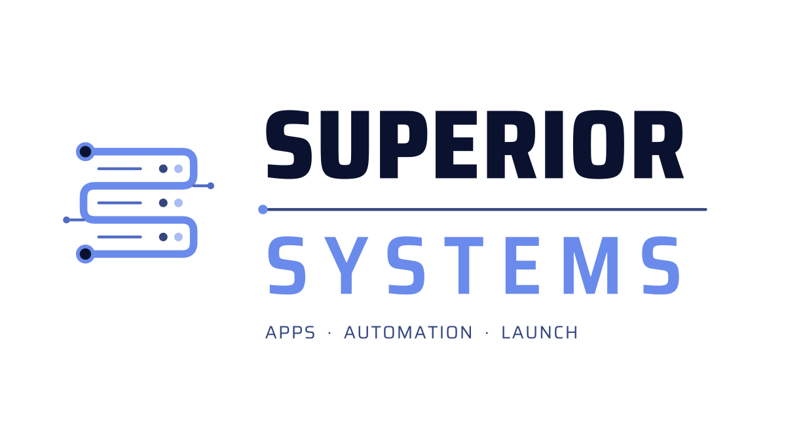

<p align="center">
  
</p>

<p align="center"><b>Open-source AI, automation &amp; developer tools. Built to run on your own hardware.</b></p>

<p align="center">
  <a href="https://superior-scale.com"></a>
  
  
  
</p>

---

Superior Systems is the open-source side of [Superior Scale](https://superior-scale.com). We publish the tools we build and use ourselves, so you can download them, run them and make them your own.

## What we build

- **Local AI & LLM tooling** for running and improving models on your own machine
- **AI agents & automation** that handle real work, not demos
- **Developer tools** that cut the busywork out of shipping
- **Security & hardening** for apps, servers and AI setups
- **Systems & Linux** builds, configs and scripts
- **Linux** custom distros, Linux From Scratch builds and system tooling
- **Hardware** hardware projects, firmware and device tooling
- **Operating systems** custom desktop and mobile OS work

## Our principles

| | |
|---|---|
| **Open source** | Code you can read, fork and change. |
| **Runs local** | Your hardware, your models, no lock-in. |
| **Privacy first** | Your data stays with you. |
| **Secure by default** | Sensible, hardened defaults out of the box. |
| **Production-grade** | Documented, tested and built to be used. |

## Featured repos

| Project | What it is | Status |
|---|---|---|
| Local AI toolkit | Tools for running and tuning models locally | Coming soon |
| Agent framework | Building blocks for AI agents and automation | Coming soon |
| Developer tools | CLIs and utilities for everyday dev work | Coming soon |
| Security toolkit | Hardening and audit tooling | Coming soon |
| Linux & OS | Custom distros, Linux From Scratch and OS tooling | Coming soon |
| Hardware | Hardware projects, firmware and device tooling | Coming soon |

## Get started

```bash
git clone https://github.com/superior-scale/<repo>.git
cd <repo>
# follow the repo's README to install and run
```

Star and watch the org to hear about new releases.

## Contributing

Issues and pull requests are welcome. Read [CONTRIBUTING.md](https://github.com/superior-scale/.github/blob/main/CONTRIBUTING.md) first, and keep it respectful.

## About

Built by the team at [Superior Scale](https://superior-scale.com) in Thunder Bay, Ontario. We build apps, automation and custom software for clients, and we put the reusable parts out here for everyone.

## Contact

[cjt@superior-scale.com](mailto:cjt@superior-scale.com)
